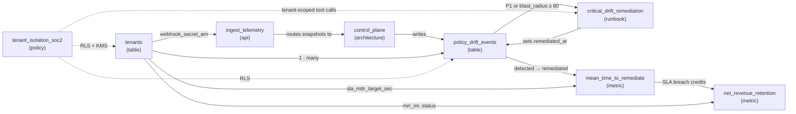

# Google OKF — ShieldPulse Knowledge Bundle & MCP Server

A machine-readable knowledge bundle for **ShieldPulse**, a fictional multi-tenant B2B MicroSaaS that detects, scores, and remediates unauthorized firewall, SD-WAN, and cloud security-group drift. The repo also includes a **read-only MCP server** that lets AI agents (Claude Code, Claude Desktop, or any MCP client) navigate the bundle as a knowledge graph.

The repo contains three parts:

| Part | Path | Purpose |
|---|---|---|
| Knowledge bundle | [`shieldpulse-okf/`](shieldpulse-okf/index.md) | OKF v0.2 concept files covering schemas, APIs, metrics, policies, and runbooks |
| Validator | [`validate-okf.sh`](validate-okf.sh) | CI-ready conformance check for frontmatter, code fences, and links |
| MCP server | [`src/google_okf/`](src/google_okf/) | Six read-only tools for agents to traverse the bundle |

---

## The Knowledge Bundle

An OKF bundle is a directory of Markdown files. Each file is one **concept**: YAML frontmatter that describes it, followed by a Markdown body that links to related concepts with relative links. Two filenames are reserved:

* **`index.md`** is the entry point. Its frontmatter lists every concept (`entries`), and its body tells agents how to traverse the bundle.
* **`log.md`** is a chronological change log. Agents should check it before relying on a schema.

### Concept Map

| Domain | Concept | Type | What it defines |
|---|---|---|---|
| Architecture | [Control Plane](shieldpulse-okf/architecture/control_plane.md) | `architecture` | Ingestion → drift evaluation → remediation pipeline *(draft)* |
| Data model | [tenants](shieldpulse-okf/tables/tenants.md) | `table` | Customers, plan tiers, MRR, SLA targets, webhook secrets |
| Data model | [policy_drift_events](shieldpulse-okf/tables/policy_drift_events.md) | `table` | Drift incidents, severity, blast radius, remediation timestamps |
| APIs | [Telemetry Ingestion Webhook](shieldpulse-okf/apis/ingest_telemetry.md) | `api` | `POST /v1/telemetry/drift-snapshot`, HMAC-authenticated |
| Metrics | [Net Revenue Retention](shieldpulse-okf/metrics/net_revenue_retention.md) | `metric` | NRR net of churn and SLA penalty credits |
| Metrics | [Mean Time to Remediate](shieldpulse-okf/metrics/mean_time_to_remediate.md) | `metric` | P1/P2 detection-to-resolution time vs. SLA |
| Governance | [Tenant Isolation (SOC2)](shieldpulse-okf/policies/tenant_isolation_soc2.md) | `policy` | Row-level security, per-tenant KMS keys, agent context scoping |
| Operations | [Critical Drift Remediation](shieldpulse-okf/runbooks/critical_drift_remediation.md) | `runbook` | P1 auto-rollback and human-in-the-loop playbook |

### How the Concepts Relate



This diagram shows the main relationships only. The bundle has more than 40 cross-links; use the `get_links` MCP tool to see all of them.

### Frontmatter Conventions

```yaml
---
type: table                  # required: architecture | table | api | metric | policy | runbook
title: "tenants"
description: "One-line summary used by agents to decide relevance."
resource: "postgresql://…"   # where the real thing lives
owners: ["data-eng@shieldpulse.io"]
tags: ["database", "billing"]
timestamp: "2026-10-17T08:35:00Z"
---
```

When you change a concept, add a dated entry to [`log.md`](shieldpulse-okf/log.md).

### Draft Content

Some content was reconstructed or inferred, because the original files were empty or cut off. It is marked in place, and you should confirm it before treating it as canonical:

* [`control_plane.md`](shieldpulse-okf/architecture/control_plane.md) has `status: "draft"`. It was reconstructed from the other concepts, and its open questions are listed at the end. Its `resource` URL is a placeholder.
* [`ingest_telemetry.md`](shieldpulse-okf/apis/ingest_telemetry.md): the **Responses** and **Security Notes** sections are drafts.
* [`mean_time_to_remediate.md`](shieldpulse-okf/metrics/mean_time_to_remediate.md): the **SLA Breach Query** is a draft. **Open Questions** flags a conflict between a monthly and a trailing 30-day SLA window.

---

## Quick Start

Requirements: Python ≥ 3.11 and [uv](https://docs.astral.sh/uv/).

```bash
git clone https://github.com/natrajexplore/Google_OKF.git
cd Google_OKF
uv sync                      # install mcp, pyyaml, and pytest

bash validate-okf.sh         # validate the bundle
uv run pytest -q             # run the tests
```

### Validate the Bundle

```bash
bash validate-okf.sh [BUNDLE_DIR]   # default: ./shieldpulse-okf
```

| Check | Fails when |
|---|---|
| Root entry point | `index.md` is missing |
| Concept typing | A concept file (anything except `index.md`/`log.md`) has no `type:` in its frontmatter |
| Code fences | A file has an unclosed code block |
| Links | A relative link points to a file that does not exist (`#anchors` are stripped; `https:`/`mailto:` links are skipped) |

The script exits `1` on any failure, so it can gate CI. `.gitattributes` pins `*.sh` to LF line endings so the script runs on Windows checkouts too.

---

## MCP Server

The server exposes the bundle to agents through six **read-only** tools. It re-reads the bundle on every call, so edits are visible without a restart. Paths are confined to the bundle directory.

| Tool | Arguments | Returns |
|---|---|---|
| `get_index` | — | Bundle title, description, `okf_version`, index entries with summaries, and the traversal guide |
| `list_concepts` | `type?` | Path, type, title, and description for each concept, optionally filtered by type (e.g. `metric`) |
| `read_concept` | `path` | Full frontmatter and Markdown body |
| `get_links` | `path` | Outgoing links and backlinks |
| `search` | `query`, `limit?` | Keyword matches (every term must match); title, description, and tag hits rank higher |
| `recent_changes` | `since?` (`YYYY-MM-DD`) | `log.md` entries, newest first |

Recommended agent flow, which the server also sends as its instructions: **`get_index` → `read_concept` / `get_links` → `recent_changes` before relying on a schema.**

### Run It

```bash
uv run google-okf [BUNDLE_DIR]      # stdio transport
```

The server looks for the bundle in this order: the CLI argument, then `$OKF_BUNDLE_DIR`, then `./shieldpulse-okf`.

### Add to Claude Code

```bash
claude mcp add okf-bundle -- uv run --directory /path/to/Google_OKF google-okf /path/to/Google_OKF/shieldpulse-okf
claude mcp get okf-bundle           # should report: ✔ Connected
```

The tools then appear as `mcp__okf-bundle__*`. To use the server in Claude Desktop or another MCP client, register the same `uv run …` command as a stdio server.

### Example

Asking *"Which concepts depend on the tenants table?"* leads an agent to call `get_links`:

```json
{
  "path": "tables/tenants.md",
  "outgoing": ["policies/tenant_isolation_soc2.md", "apis/ingest_telemetry.md", "tables/policy_drift_events.md",
               "metrics/net_revenue_retention.md", "metrics/mean_time_to_remediate.md"],
  "backlinks": ["apis/ingest_telemetry.md", "architecture/control_plane.md", "metrics/mean_time_to_remediate.md",
                "metrics/net_revenue_retention.md", "policies/tenant_isolation_soc2.md",
                "runbooks/critical_drift_remediation.md", "tables/policy_drift_events.md"]
}
```

### Security Model

The bundle contains **structural knowledge only**: no tenant data, credentials, or live connections. This follows the bundle's own [isolation policy](shieldpulse-okf/policies/tenant_isolation_soc2.md): agents may read the bundle freely, but any live query they build from it must be scoped to the authenticated `tenant_id`. Every tool is annotated `readOnlyHint`. Unknown or out-of-bundle paths (for example `../pyproject.toml`) return a tool error.

> Built on the MCP Python SDK **2.x** (`mcp.server.mcpserver.MCPServer`). In 2.x, the 1.x `FastMCP` class was renamed, so most older online examples won't match this code.

---

## Project Layout

```
.
├── shieldpulse-okf/            # the OKF knowledge bundle
│   ├── index.md                #   entry point (reserved)
│   ├── log.md                  #   change log (reserved)
│   ├── architecture/  apis/  metrics/  policies/  runbooks/  tables/
├── src/google_okf/
│   ├── __init__.py             # main(): runs the MCP server over stdio
│   ├── bundle.py               # loader: frontmatter, links, backlinks, search, log
│   └── server.py               # MCP tool definitions
├── tests/test_bundle.py        # loader, server, and real-bundle integrity tests
├── validate-okf.sh             # bundle conformance check
└── pyproject.toml
```

## Roadmap

- [ ] Resolve the open questions in `control_plane.md` and `mean_time_to_remediate.md`, and replace the draft sections with sourced content
- [ ] Add a CI workflow that runs `validate-okf.sh` and `pytest` on every push
- [ ] Build the reference ShieldPulse service the bundle describes (FastAPI webhook, PostgreSQL with RLS, MTTR/NRR queries)

## License

[MIT](LICENSE) © 2026 Nataraj Angappan
